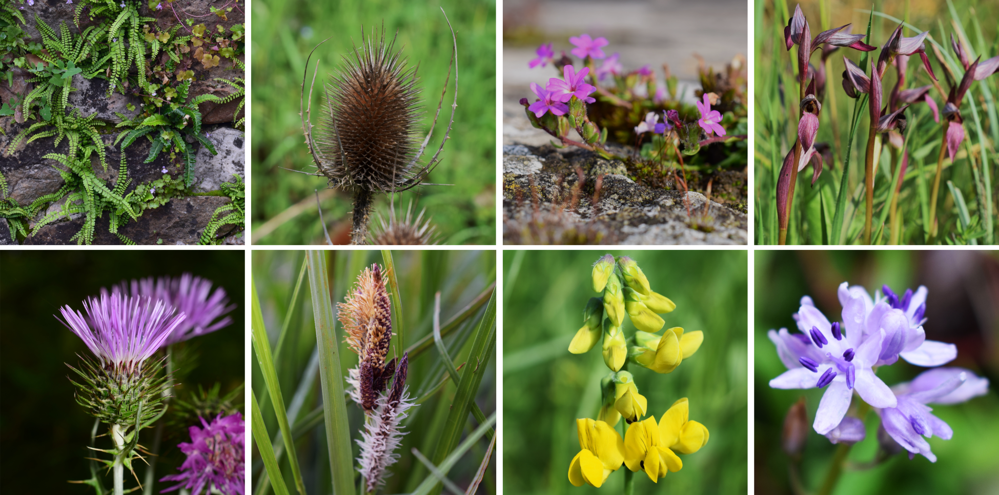

---

---

**Human-altered environments**—such as urban areas, industrial sites, abandoned quarries, and roadsides—are increasingly common across the planet. These spaces can host surprising levels of **biodiversity**, but they also face major challenges: habitat degradation, biological invasions, and the loss of native species. To restore these landscapes and make them resilient, we need to understand how plants regenerate under such conditions.

**SeedAnthropic** is a research project that explores the role of seeds in shaping plant communities in anthropogenic and invaded habitats. **Seeds** are the starting point of plant life, and their traits—such as dispersal ability, dormancy, and germination timing—determine whether species can establish and persist in disturbed environments. By studying these traits, we aim to uncover the mechanisms that allow native plants to coexist with humans and **resist invasive species**.

Our approach combines global synthesis and local experimentation. At the **global scale**, we analyze thousands of records to identify patterns in seed traits of synanthropic (human-associated) plants and compare them with invasive species. At the **regional scale**, we focus on the Cantabrian Mixed Forests ecoregion, a biodiversity hotspot in northern Spain, where we survey invaded habitats and test native seed mixes designed for ecological restoration. These mixes will be evaluated in greenhouse trials and real-world restoration sites, in collaboration with seed producers and land managers.

**SeedAnthropic** embraces open science principles: all data and protocols will be shared openly to support future research and practical applications. Beyond its scientific goals, the project promotes public engagement through citizen science initiatives and outreach activities, highlighting the cultural and ecological value of native plants.

The **SeedAnthropic** project (2025-2029) is co-led by Eduardo Fernández-Pascual and Adrián Lázaro-Lobo at the University of Oviedo.

Project SeedAnthropic [PID2024-156390NB-I00] funded by MICIU/AEI/10.13039/501100011033/FEDER, EU.

*Our vision: to turn degraded spaces into biodiverse, resilient habitats by harnessing the power of seeds.*

---

**Related publications**

* Fernández-Pascual E, Ferencova Z, Espinosa del Alba C, González-García V, Jiménez-Alfaro B, & Lázaro-Lobo A (2026) [Seeds in the City: Regeneration strategies across urban species pools](https://doi.org/10.1016/j.ufug.2026.129554). *Urban Forestry & Urban Greening* 123, 129554.

* Fernández-Pascual E, Ferencova Z, González-García V, & Jiménez-Alfaro B (2026) [Compositional novelty of plant, fungal and bacterial communities across urban habitats](https://doi.org/10.1016/j.landurbplan.2025.105517). *Landscape and Urban Planning* 265, 105517.

* Fernández-Pascual E, González-García V, Ivesdal G, Lázaro-Lobo A, & Jiménez-Alfaro B (2025) [Classification and characterization of anthropogenic plant communities in the northwestern Iberian Peninsula](https://doi.org/10.1111/avsc.70010). *Applied Vegetation Science* 28, e70010.

* Lázaro-Lobo A, Rendueles Fernández B, Fernández-Pascual E, González-García V, & Jiménez-Alfaro B (2025) [Invasive plants have a delayed and longer flowering phenology than native plants in an ecoregional flora](https://doi.org/10.1093/aob/mcaf078). *Annals of Botany* 136, 367-375.

* Lázaro-Lobo A, Wessely J, Essl F, Moser D, & Jiménez-Alfaro B (2025) [Combining hierarchical distribution models with dispersal simulations to predict the spread of invasive plant species](https://doi.org/10.1111/geb.70026). *Global Ecology and Biogeography* 34, e70026.

* Lázaro-Lobo A, Campos JA, Díaz González TE, Fernández-Pascual E, González-García V, Marchante H, Romero Buján MI, & Jiménez-Alfaro B (2024) [An ecoregion-based approach to evaluate invasive plant species pools](https://doi.org/10.3897/neobiota.96.116105). *NeoBiota* 96, 105-128.

* Lázaro-Lobo A, Alonso-Zaldívar H, Martínez Sagrera SJ, Espinosa del Alba C, Fernández-Pascual E, González-García V, & Jiménez-Alfaro B (2024) [Regeneration niche of *Cortaderia selloana* in an invaded region: Flower predation, environmental stress, and transgenerational effects](https://doi.org/10.1016/j.stress.2024.100483). *Plant Stress* 12, 100483.
