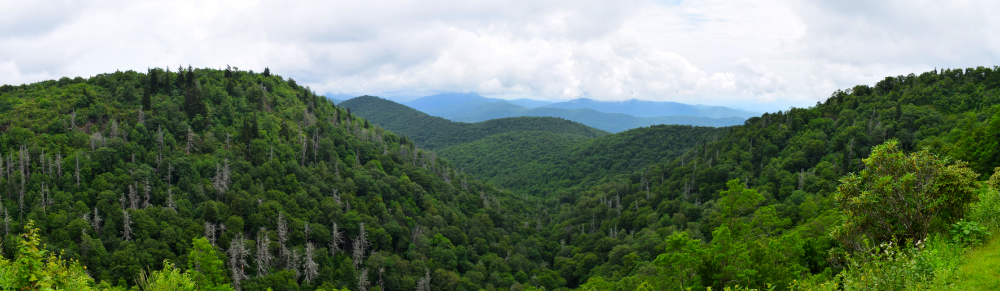

---

`SylvanSeeds` is a database of seed germination ecology for the temperate broadleaf and mixed forest biome of the northern hemisphere. It contains data on >300 plant species, obtained from >500 published references. The data are germination proportions recorded under experimental combinations of temperature, light, scarification and stratification.

The SylvanSeeds data are now integrated into [SeedArc](https://www.unioviedo.es/seedarc/index.html), a global archive of primary seed germination data, together with germination data from other biomes worldwide.

## How to access SylvanSeeds

* [Get the database in `.csv` format](https://github.com/efernandezpascual/sylvanseeds/blob/master/data/TBMF_Database.csv)
* [Check the `shiny` app for visualizing the dataset](https://efernandezpascual.shinyapps.io/sylvanseeds/)
* Read the [data paper](https://doi.org/10.1111/jvs.12960) describing the collection and fields of the dataset, published in the *Journal of Vegetation Science* (also available as a [preprint on GitHub](https://github.com/efernandezpascual/sylvanseeds/blob/master/doc/manuscript.md)).

## Citation

Please cite `SylvanSeeds` as:

> Fernández-Pascual E (2021) [SylvanSeeds, a seed germination database for temperate deciduous forests.](https://doi.org/10.1111/jvs.12960) *Journal of Vegetation Science* 32, e12960.